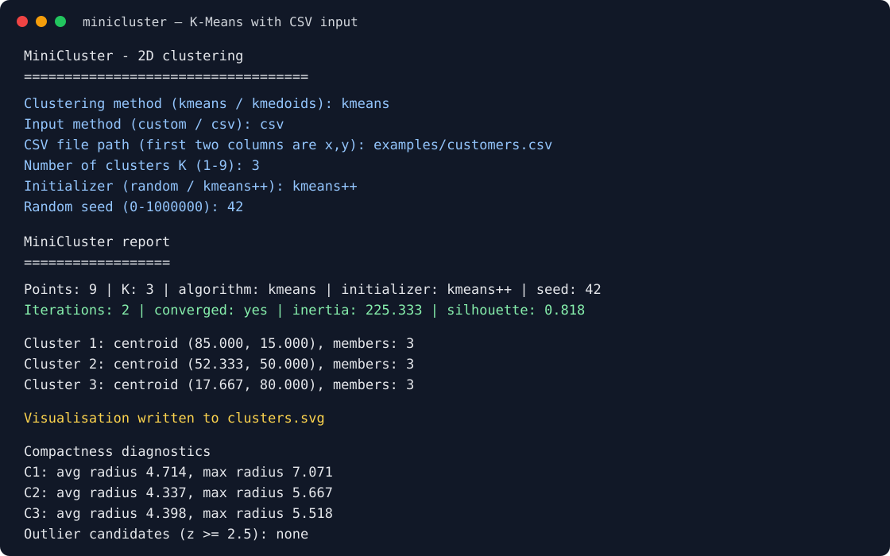
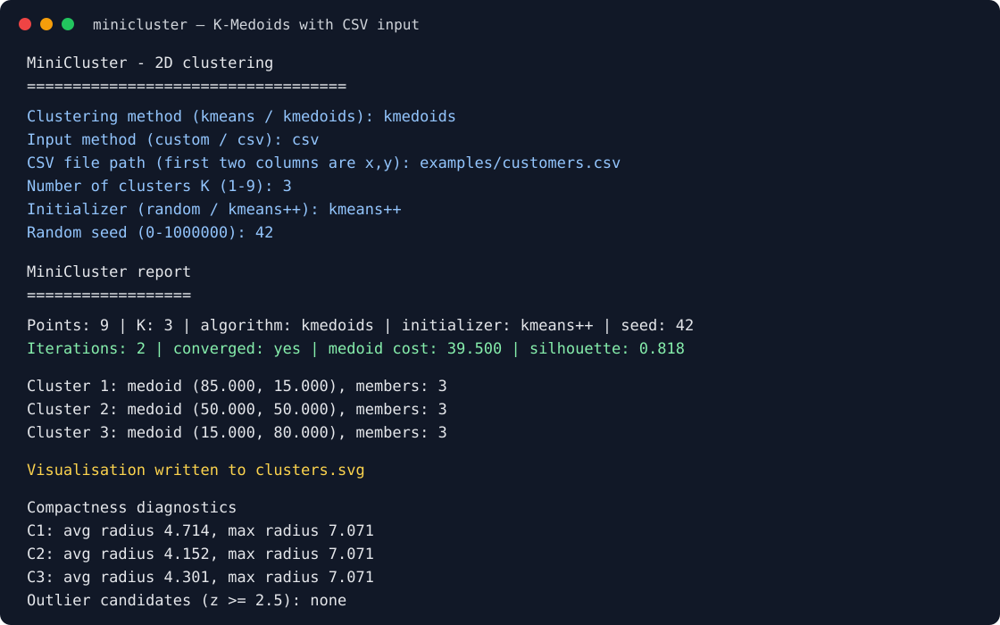

# MiniCluster

MiniCluster is a small C++17 program that groups customers using **K-Means** or **K-Medoids** clustering. Each customer is a 2D point, such as annual income and spending score. At startup, choose both the clustering method and input method: enter custom points or load a CSV file. The program then reports the resulting clusters, diagnostics, and an SVG plot.

It uses only the standard C++ library.

## Build and run

```bash
g++ -std=c++17 -Iinclude src/*.cpp -o minicluster
./minicluster
```

The first two prompts make the available modes explicit:

```text
Clustering method (kmeans / kmedoids):
Input method (custom / csv):
```

## Data input

At startup choose `custom` to enter points one at a time, or `csv` to load a file. CSV files must have numeric `x,y` values in their first two columns. One optional header row is supported, blank rows are ignored, and up to 1,000 points can be loaded.

For example, the included sample can be selected with:

```text
Clustering method (kmeans / kmedoids): kmedoids
Input method (custom / csv): csv
CSV file path (first two columns are x,y): examples/customers.csv
```

For a larger test, use `examples/large_customers.csv`. It contains 600 deterministic sample customers across four broadly separated income/spending groups and remains within the program's 1,000-point CSV limit.

## Visualisation

Every completed run writes `clusters.svg` in the directory where `minicluster` is run. Open that file in a browser to see a scatter plot of the points, coloured by cluster. K-Means centroids appear as crosses; K-Medoids medoids appear as diamonds. The chart includes axes, scale labels, a cluster legend, and point-coordinate tooltips.

## Example run

Text after each prompt is what the user typed.

```text
MiniCluster - 2D clustering
============================
Clustering method (kmeans / kmedoids): kmeans
Input method (custom / csv): custom
How many points? (1-1000): 9
Point 1 (income score): 15 80
Point 2 (income score): 18 75
Point 3 (income score): 20 85
Point 4 (income score): 50 50
Point 5 (income score): 55 45
Point 6 (income score): 52 55
Point 7 (income score): 85 15
Point 8 (income score): 80 20
Point 9 (income score): 90 10
Number of clusters K (1-9): 3
Initializer (random / kmeans++): kmeans++
Random seed (0-1000000): 42

MiniCluster report
==================
Points: 9 | K: 3 | algorithm: kmeans | initializer: kmeans++ | seed: 42
Iterations: 2 | converged: yes | inertia: 225.333 | silhouette: 0.818

Cluster 1: centroid (52.333, 50.000), members: 3
Cluster 2: centroid (85.000, 15.000), members: 3
Cluster 3: centroid (17.667, 80.000), members: 3

Compactness diagnostics
  C1: avg radius 4.337, max radius 5.667
  C2: avg radius 4.714, max radius 7.071
  C3: avg radius 4.398, max radius 5.518
Outlier candidates (z >= 2.5): none
```

## Run snapshots

K-Means with the included CSV sample:



K-Medoids with the same CSV sample:



Points can be typed as `45 60` or `45,60`. Invalid input (letters, a missing number, K larger than the number of points, and so on) is rejected and the question is asked again.

## How K-Means works

1. **Pick starting centroids.** Choose K points to be the first cluster centers.
2. **Assign.** Give every point to its nearest centroid (by Euclidean distance).
3. **Update.** Move each centroid to the average position of the points assigned to it.
4. **Repeat** steps 2 and 3 until the centroids barely move (or the iteration limit is reached).
5. **Report** the final clusters.

If a cluster ends up with no points, its centroid is moved to the point that is farthest from every centroid, so the algorithm can continue.

### Starting strategies

- **random:** picks K different data points at random.
- **kmeans++:** picks the first centroid at random, then picks each next one with probability proportional to its squared distance from the nearest centroid already chosen. This spreads the starting centroids out and usually gives better results.

The same seed always gives the same result, so runs can be repeated and compared.

## How K-Medoids works

K-Medoids uses the same assign-and-update loop, but each cluster centre is always an existing data point (the **medoid**). In the update step, it tries every member of a cluster as the potential medoid and keeps the one with the smallest total Euclidean distance to the other members. This makes it less sensitive to outliers than K-Means, whose centroids are arithmetic averages. Its `medoid cost` is the total distance to medoids, so it is distinct from K-Means inertia and should only be compared between K-Medoids runs on the same data.

## What the report numbers mean

- **Inertia:** total squared distance from each point to its centroid. Smaller means tighter clusters. It almost always drops as K grows, so it cannot choose K by itself.
- **Silhouette:** from -1 to 1. Near 1 means well-separated clusters, near 0 means overlapping clusters, below 0 means a point may belong in another cluster.
- **Average / max radius:** how far, on average and at most, a cluster's points are from its centroid.
- **Outlier candidates:** points whose distance from their centroid is at least 2.5 standard deviations above their cluster's average. This is a hint to look closer, not proof that the data is wrong.

## Project structure

```text
include/data_point.h    Point type and distance functions
include/initializers.h  Centroid initializer interface, random and K-Means++
include/kmeans.h        Cluster type and the KMeans class
include/kmedoids.h      KMedoids class (representatives are input points)
include/analytics.h     Silhouette, cluster radius, outlier detection
include/input.h         Reading manual points, CSV files, and settings
src/                    Implementation of each header, plus main.cpp
```

## Limitations

K-Means works best on roughly round, similarly sized groups and is sensitive to outliers. K-Medoids is more robust to outliers but takes more work per iteration, especially for large clusters. You must choose K yourself, so compare inertia or medoid cost together with silhouette for several values of K. Silhouette compares every pair of points, so it gets slow for very large datasets (the input is limited to 1000 points).
